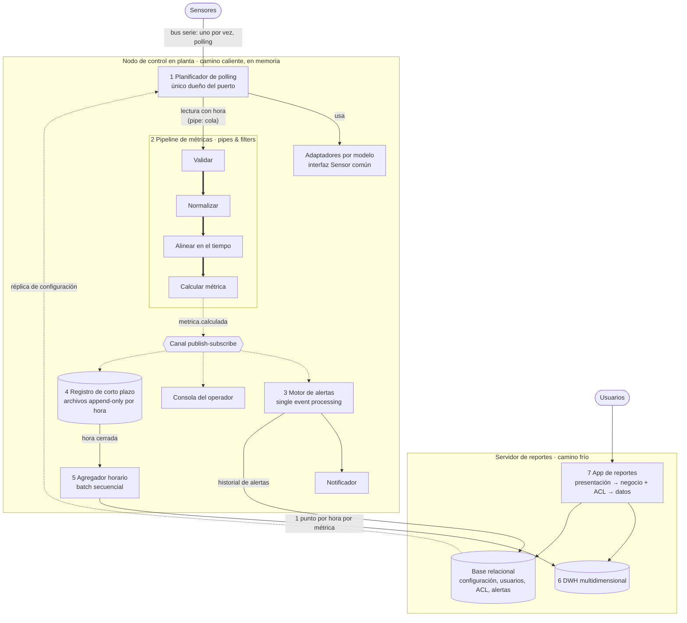
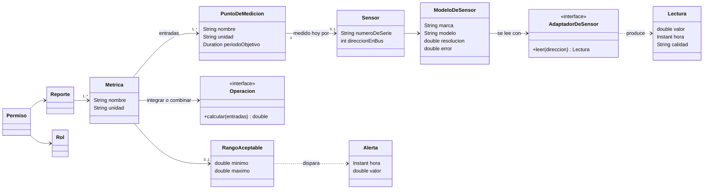
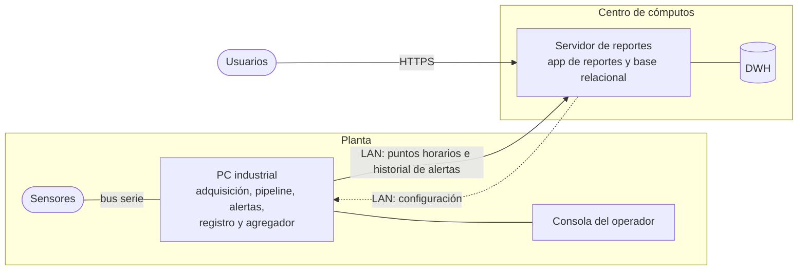

# Ejercicio de parcial rotulado 2013 — Control de una fábrica

## Consigna

> 1. [6 ptos] Dado el siguiente caso:
>
> Se requiere realizar un sistema de control en una fábrica. Para esto se tomarán datos de sensores distribuidos por la planta por medio de una interfaz serie, que tiene una velocidad de transferencia bastante limitada. La comunicación con los sensores es por medio de polling: ante un pedido del sistema, el sensor retorna el valor actualmente sensado. Dado que se utiliza una interfaz serie, sólo se puede hablar con un sensor por vez.
>
> Las métricas que importa controlar dentro de la fábrica, no siempre son directamente las censadas, sino que estos valores deben ser procesados de diversas formas (integrados en el tiempo, combinados con otras métricas, etc.). Por ejemplo, interesa medir volumen de agua que pasa por un caño (metros cúbicos), pero el sensor utilizado es un caudalímetro (metros cúbicos por segundo); o interesa medir el consumo eléctrico (Watts), y para ello se cuenta con voltímetros y amperímetros. Estos cómputos no siempre son sencillos.
>
> Dado que el sistema es de control, es fundamental que la frecuencia de sensado sea lo más alta posible, de modo de poder disparar alertas cuando algún parámetro está fuera del rango aceptable.
>
> Adicionalmente interesa almacenar esta información para poder generar reportes de tendencia. Estos reportes obviamente no precisan la información en tiempo real, sino que la necesitan agregada, de forma de minimizar los puntos a ser utilizados en los reportes y así permitir consultas más veloces. Siendo así, alcanza con un punto por hora por métrica. No todos los reportes son accesibles a todos los usuarios, debiéndose implementar un ACL.
>
> El sistema deberá funcionar en la fábrica por varios años. Los sensores, como dispositivos físicos que son, se romperán y deberán ser cambiados con el transcurso del tiempo. Como es natural en el mundo del hardware, las marcas, modelos y prestaciones de los sensores que se usarán en el futuro muy posiblemente sean distintos (mayor resolución, menor error de sensado, etc.).
>
> Analizar:
> a. Necesidad del cliente (en menos de 40 palabras).
> b. Punteo de funcionalidades de alto nivel (al menos 5 items).
> c. Atributos de calidad prioritarios en un árbol de utilidad (los primeros 2 niveles).
>
> Definir:
> d. Una arquitectura candidata y justificarla (texto, gráficos, lo que sea necesario).
> e. Indicar cómo se resuelven los atributos de calidad del punto (1.c).
> f. Indicar riesgos/no riesgos, supuestos y tradeoffs tomados.
>
> [EJ-2013, p. 1]

Por ahora está resuelto el **1.d**. Los puntos a, b, c, e y f quedan pendientes.

## Cómo leer el caso

Cada párrafo del enunciado esconde un *driver*: una restricción o un atributo de calidad que obliga a tomar una decisión de arquitectura. **Inferencia:** detectarlos es la mitad del ejercicio, porque el 1.c los prioriza y el 1.d tiene que responder a cada uno.

| Párrafo | Qué dice | Qué hay detrás | Tema del parcial que lo resuelve |
|---|---|---|---|
| 1 | Interfaz serie lenta, polling, un sensor por vez | Una **restricción técnica** que pone techo a la frecuencia de sensado. El cuello de botella es el bus, no la CPU: un servidor más potente no sensa más rápido. | Vista de procesos; performance |
| 2 | Las métricas útiles se calculan: integrar en el tiempo, combinar sensores | Un flujo continuo de datos que pasa por etapas de transformación | [Pipes & filters](../../wiki/temas/estilos-arquitectonicos.md#dataflow) |
| 3 | Frecuencia lo más alta posible; alertas fuera de rango | **Performance** (latencia de detección) y reacción a cada valor | [Single event processing](../../wiki/temas/estilos-arquitectonicos.md#sistemas-basados-en-eventos) |
| 4 | Reportes de tendencia sin tiempo real, un punto por hora, ACL | Un segundo camino, agregado y sin urgencia; **seguridad** (autorización) | [Batch secuencial](../../wiki/temas/estilos-arquitectonicos.md#dataflow) y [bases multidimensionales](../../wiki/temas/persistencia.md#bases-de-datos-multidimensionales) |
| 5 | Años de operación; sensores que se rompen y se reemplazan por otros modelos | **Modificabilidad** y tolerancia a fallas de sensores | Capas y adaptadores, como en el [integration hub](../../wiki/temas/arquitecturas-de-integracion.md#integration-hub) |

## Qué pide cada punto

El ejercicio vale 6 puntos en total, sin desglose por inciso. [EJ-2013, p. 1] Los tres primeros analizan el problema y los tres últimos definen la solución.

- **a. Necesidad del cliente.** Qué problema del cliente se resuelve, en menos de 40 palabras y sin hablar de tecnología. Ninguna fuente de la cátedra define cómo formularla; ver [Consignas de práctica](../../wiki/consignas-de-practica.md).
- **b. Funcionalidades de alto nivel.** Requerimientos funcionales, redactados con verbos. El texto trae más de cinco: casi cada párrafo aporta uno o dos.
- **c. Árbol de utilidad con dos niveles.** La raíz es *Utility*, el primer nivel son los atributos de calidad y el segundo, sus refinamientos. [CL09-P, p. 26] **Inferencia:** «los primeros 2 niveles» no exige hojas con escenarios y el par [importancia, dificultad]. El Cross Challenge pide lo mismo con otras palabras: «atributos de calidad relevantes y, para cada uno, subatributos o escenarios generales». [CROSS-2026-05, p. 2] Agregar un escenario medible por rama muestra criterio.
- **d. Arquitectura candidata justificada.** Arquitectura = vistas + estilos. [CL08-P, p. 58] Justificar es vincular cada decisión con un driver del caso.
- **e. Cómo se resuelve cada atributo del c.** Una correspondencia entre atributo y decisión del d. **Inferencia:** si un atributo del árbol no tiene una decisión que lo atienda, al d le falta algo.
- **f. Riesgos, no riesgos, supuestos y trade-offs.** Son hallazgos de ATAM [CL09-P, p. 28], más los supuestos, que no son una salida de ATAM y se piden aparte. Ver [hallazgos de ATAM](../../wiki/temas/evaluacion-de-arquitecturas.md#fase-2-análisis-de-los-enfoques-arquitectónicos).

**Lo que probablemente busca el corrector (inferencia):**

1. Que se vea que el cuello de botella es el bus serie.
2. Que el control en tiempo real quede separado de los reportes agregados.
3. Que los sensores queden aislados detrás de una interfaz común.
4. Que se note que combinar sensores leídos en instantes distintos exige marcar cada lectura con su hora.
5. Que no se olviden el ACL ni la detección de sensores rotos.

## Resolución del 1.d — Arquitectura candidata

### Drivers que se toman del 1.c

El 1.d depende del árbol de utilidad del 1.c, que todavía no está resuelto. Se toman como prioridades, en este orden:

1. **Performance del control:** frecuencia de sensado y latencia entre la lectura y la alerta.
2. **Modificabilidad:** reemplazar sensores por otros modelos y agregar métricas derivadas.
3. **Disponibilidad del control:** seguir sensando y alertando durante años, aunque falle un sensor, la red o el servidor de reportes.
4. **Seguridad:** ACL sobre los reportes.
5. **Performance de los reportes:** consultas rápidas sobre datos agregados.

### Supuestos

El enunciado no fija estos puntos. Si alguno cambia, puede cambiar la arquitectura.

1. **Escala.** Una planta, un único bus serie y del orden de decenas a centenas de sensores.
2. **Alcance del control.** El sistema monitorea y alerta, pero no acciona válvulas ni motores: el enunciado solo habla de alertas.
3. **Hardware.** En planta hay un equipo conectado al bus que puede correr software, como una PC industrial. Los usuarios de reportes acceden por la red de la empresa.
4. **Protocolos.** Cada modelo de sensor tiene su propio formato de pedido y respuesta, sus escalas y sus unidades, aunque todos comparten el bus.
5. **Alertas.** Se muestran en una consola de operador y se notifican por algún medio, como una sirena o un mensaje. El enunciado no dice cuál.

### La arquitectura en una frase

Un **nodo de control en planta** resuelve en memoria el camino caliente —adquisición, cálculo de métricas y alertas— sin depender de la red ni de una base de datos. Un **camino frío** agrega cada hora y carga un data warehouse, que consulta una aplicación de reportes con ACL. Los sensores quedan aislados detrás de **adaptadores** con una interfaz común.

### Vista de procesos

| # | Componente | Responsabilidad | Estilo |
|---|---|---|---|
| 1 | Planificador de polling y adaptadores | Es el único componente que habla con el bus. Elige el próximo sensor según el plan de polling, le pide el valor mediante el adaptador de su modelo, registra la hora de la lectura y la deja en una cola. No calcula ni persiste nada. | Capas y adaptadores |
| 2 | Pipeline de métricas | Convierte lecturas en métricas. **Validar:** valores físicamente imposibles, timeouts y sensores sin respuesta. **Normalizar:** unidades y calibración. **Alinear:** último valor válido de cada entrada, con su antigüedad. **Calcular:** integrar o combinar. | Pipes & filters |
| 3 | Motor de alertas | Compara cada métrica con su rango aceptable y dispara una alerta cuando sale de él. También alerta cuando un sensor deja de responder. | Single event processing |
| 4 | Registro de corto plazo | Guarda las métricas de las últimas horas o días en un archivo *append-only* por hora. Permite reprocesar una hora y conservar los datos si el servidor no responde. | Persistencia en archivos |
| 5 | Agregador horario | Al cerrar cada hora, lee el archivo de esa hora, calcula un punto por métrica y lo carga en el DWH. El agregado depende de la métrica: total para el volumen y promedio, mínimo y máximo para la potencia. Si la carga falla, reintenta. | Batch secuencial |
| 6 | DWH | Hechos horarios por métrica, con dimensiones de tiempo, métrica y sector de planta. | Persistencia multidimensional |
| 7 | App de reportes | Reportes de tendencia. La capa de negocio verifica el ACL antes de cada consulta. | Capas y MVC |
| — | Canal publish–subscribe | Reparte cada métrica entre sus consumidores sin que el pipeline los conozca. **Inferencia:** puede ser un bus en memoria dentro del nodo; no hace falta un broker externo. | Publish–subscribe |
| — | Administración | Alta, baja y modificación de sensores, puntos de medición, métricas, rangos, usuarios y permisos. | — |

### Decisiones clave

**D1. El bus es el recurso escaso: el ciclo de polling no hace otra cosa.** La frecuencia máxima de sensado la fija el bus, porque cada consulta ocupa el puerto hasta que responde el sensor. Cualquier otra tarea dentro del ciclo —calcular, escribir en una base, esperar a un consumidor— baja esa frecuencia. Por eso el planificador lee, registra la hora, deja la lectura en la cola y vuelve al bus. El resto corre en otros hilos, desacoplado por la cola, que cumple el papel de *pipe*.

*Ejemplo ilustrativo (supuesto, conocimiento general):* a 9600 bps, una consulta con su respuesta y la demora del sensor puede tardar unos 30 ms. Eso da unas 33 lecturas por segundo **en total**. Con 100 sensores leídos en ronda, cada uno se leería cada 3 segundos.

**D2. Plan de polling por prioridad, no una ronda pareja.** Como no se puede leer todo a la máxima frecuencia, cada punto de medición tiene un período objetivo según su criticidad y su dinámica. Una presión crítica se lee más seguido que la temperatura de un tanque grande, que cambia despacio. El planificador elige siempre el punto más atrasado respecto de su período. Cada pedido tiene un timeout corto, para que un sensor roto no trabe el bus. **Inferencia:** se puede subir la prioridad de un punto cuando su valor se acerca al límite. Así, «lo más alta posible» se cumple donde importa.

**D3. Separar el camino caliente del frío.** Adquisición, métricas y alertas corren en memoria en el nodo de planta: en el camino de una alerta no hay red, base de datos ni DWH. Los reportes se alimentan cada hora y en forma asincrónica. Si se cae el servidor de reportes, las alertas siguen funcionando, y el registro de corto plazo guarda los datos hasta que la carga vuelva a funcionar.

**D4. Aislar el hardware detrás de adaptadores.** Todos los sensores se leen mediante una interfaz común, `Sensor`, que devuelve el valor en unidades físicas junto con la resolución y el error del modelo. Cada modelo tiene su adaptador, que conoce su protocolo y sus escalas. Así:

- reemplazar un sensor roto por otro del mismo modelo es solo un cambio de configuración;
- incorporar un modelo nuevo requiere programar un adaptador y registrarlo, sin tocar el planificador, el pipeline, las alertas ni los reportes;
- como las lecturas informan su resolución y su error, los filtros no dependen de las prestaciones de un modelo en particular.

Es la misma idea que el integration hub de la clase 11, que se conecta con cada sistema mediante adaptadores [CL11-INT, p. 3], y que las capas, que «suponen reusabilidad y fácil intercambio». [CL08-P, p. 29]

**D5. Las métricas se definen sobre puntos de medición, no sobre sensores.** «Caudal del caño 3» es un **punto de medición**; el sensor que hoy lo mide es un atributo reemplazable. Las métricas derivadas se configuran como una composición de operaciones sobre puntos: «volumen del caño 3» integra el caudal y «consumo del motor 2» multiplica tensión por corriente. Cuando se cambia un sensor, las métricas, los rangos de alerta y la historia en el DWH no se cortan.

**D6. Combinar lecturas que no son simultáneas.** Como el bus lee un sensor por vez, la tensión y la corriente nunca se miden en el mismo instante. El filtro de alineación toma el último valor válido de cada entrada y marca la métrica como degradada si alguna entrada supera una antigüedad máxima. La integración usa el intervalo real entre lecturas, no un período fijo: con la regla del trapecio, volumen += (q₁ + q₂) / 2 × Δt. **Inferencia:** por eso la hora la registra el planificador en el momento de leer, y no un filtro posterior.

**D7. El ACL vive en la capa de negocio de la app de reportes.** Un permiso relaciona un rol o un usuario con un reporte. La capa de negocio lo verifica antes de consultar el DWH, y la presentación solo muestra los reportes permitidos. Permisos y usuarios se guardan en la base relacional.

### Estilos y por qué

| Estilo | Dónde | Qué problema del caso resuelve | Fuente |
|---|---|---|---|
| Capas y adaptadores | Acceso a sensores | Cambiar sensores sin tocar el resto: cada capa abstrae a la inferior | [CL08-P, p. 28]; [CL08-P, p. 29]; [CL11-INT, p. 3] |
| Pipes & filters | Cálculo de métricas | La palabra clave es «flujo»: validar, transformar y combinar un flujo continuo con filtros independientes | [CL08-P, p. 27]; [CL08-P, p. 33] |
| Publish–subscribe | Salida del pipeline | Varios consumidores de cada métrica —alertas, consola, registro— que el productor no conoce. Es el ejemplo IoT de la clase: sensores que publican en un tópico, con monitoreo, control y dashboards suscriptos. | [CL08-P, p. 39]; [CL08-P, p. 41] |
| Single event processing | Alertas | Cada métrica se evalúa por sí sola contra su rango. Es el ejemplo del repaso: un sensor de temperatura que dispara una alarma si pasa de 30 °C. | [CL08-P, p. 54]; [CL12-REP, p. 7] |
| Batch secuencial | Agregación horaria | Los reportes no necesitan tiempo real, y un pipeline donde no importa la latencia es el caso de uso del batch | [CL08-P, p. 26] |
| Capas (tres) y MVC | App de reportes | Separar presentación, negocio —donde vive el ACL— y datos | [CL08-P, p. 31]; [CL08-P, p. 50] |

Combinar estilos es válido porque cada uno se aplica en un contexto distinto. [CL08-P, p. 24]

### Persistencia

| Qué se guarda | Mecanismo | Por qué |
|---|---|---|
| Métricas de las últimas horas o días | Archivos planos *append-only*, uno por hora | Un solo escritor y un solo lector, sin consultas complejas. La clase recomienda archivos para logs y resultados de procesos batch. [CL11-P, p. 5]; [CL11-P, p. 23] |
| Un punto por hora por métrica | Base multidimensional (DWH), con un esquema estrella: hecho «valor horario» y dimensiones tiempo, métrica y sector | Es el caso típico: datos extraídos, transformados y agregados, optimizados para lectura, para reportes históricos. [CL11-P, p. 11]; [CL11-P, p. 24] |
| Configuración, usuarios, ACL e historial de alertas | Base relacional | Datos estructurados que requieren integridad, como en un sistema transaccional. [CL11-P, p. 10]; [CL11-P, p. 23] |

**Inferencia:** si en el futuro se sumaran varias plantas, el registro de corto plazo podría pasar a una NoSQL columnar, que la clase recomienda para telemetría, IoT y métricas. [CL11-P, p. 15]; [CL11-P, p. 24] Con un solo bus serie, el volumen no lo justifica.

### Vista lógica

Una métrica directa, como el caudal, tiene un solo punto de entrada y la operación identidad. La relación de cero o un sensor por punto refleja que el punto existe aunque su sensor esté roto o fuera de servicio.

### Vista física

El nodo de planta es autónomo: si se corta la red, sigue sensando, calculando y alertando con su copia de la configuración, y el agregador reintenta la carga más tarde. **Para el 1.f:** la PC industrial es un punto único de falla del control.

### Escenarios (+1)

**E1 — Alerta por caudal alto.**

1. El planificador detecta que «caudal del caño 3» es el punto más atrasado y le pide el valor al caudalímetro mediante su adaptador.
2. Registra la hora, deja la lectura en la cola y vuelve al bus.
3. El pipeline valida y normaliza a m³/s, y publica la métrica de caudal. El filtro de integración actualiza el volumen con el intervalo real desde la lectura anterior.
4. El motor de alertas recibe el caudal, ve que está fuera de rango y dispara la alerta; el notificador avisa en la consola y al responsable.
5. En paralelo, el registro guarda las dos métricas. Al cerrar la hora, el agregador carga en el DWH el volumen total de esa hora.

En los pasos 1 a 4 no hay red ni base de datos.

**E2 — Reemplazo de un voltímetro roto por un modelo nuevo.**

1. Mientras el sensor está roto, cada pedido vence por timeout sin trabar el bus. El validador marca la lectura como fallida y el motor de alertas avisa «sensor sin respuesta». «Consumo del motor 2» queda marcada como degradada.
2. Si el modelo nuevo ya tiene adaptador, el técnico da de alta el sensor y lo asocia al punto «tensión del motor 2». No hay que hacer nada más.
3. Si el modelo es nuevo, se programa un adaptador que implementa la interfaz común y se lo registra. El planificador, el pipeline, las alertas y los reportes no cambian.
4. La métrica sigue calculándose sobre el mismo punto, y su historia en el DWH no se corta.

**E3 — Reporte con ACL.** Un supervisor pide el reporte mensual de consumo eléctrico. La capa de negocio verifica su permiso y consulta el DWH, que devuelve unos 720 puntos por métrica (30 días × 24 horas), y la vista los grafica. Un usuario sin permiso no ve ese reporte en el menú; si lo pide directamente, la capa de negocio lo rechaza.

### Alternativas descartadas

- **Calcular dentro del ciclo de polling.** Es más simple, pero cada cómputo costoso baja la frecuencia de sensado (D1).
- **Todo en batch: leer, guardar y procesar después.** Las alertas llegarían tarde. El batch tiene alta latencia [CL08-P, p. 26], así que queda solo para los reportes.
- **Guardar todas las lecturas y armar los reportes al vuelo.** Contradice el pedido de un punto por hora para que las consultas sean veloces. [EJ-2013, p. 1] El DWH está pensado para lecturas agregadas, no para escritura intensiva. [CL11-P, p. 24]
- **Broker o client–dispatcher–server.** El broker resuelve «desacoplar y enrutar» mediante un intermediario central [CL08-P, p. 36], y client–dispatcher–server, la distribución y la disponibilidad balanceando carga entre servidores. [CL08-P, p. 45] **Inferencia:** acá hay un solo bus y un solo nodo de adquisición, así que no hay nada que enrutar ni balancear.
- **Complex event processing para las alertas.** Detecta patrones que combinan varios eventos. [CL08-P, p. 54] No hace falta para un rango simple. **Inferencia:** queda como evolución si se quiere alertar por tendencias —por ejemplo, una presión que sube rápido— o filtrar ruido exigiendo varias lecturas seguidas fuera de rango.

### Lo que cuesta

Se detalla en el 1.f; acá se nombra para que la justificación quede completa:

- coordinar los filtros es más complejo [CL08-P, p. 27];
- en un sistema basado en eventos cuesta reproducir situaciones y rastrear una operación de punta a punta [CL08-P, p. 56];
- la PC de planta es un punto único de falla;
- los reportes pueden estar hasta una hora desactualizados, algo que el enunciado acepta. [EJ-2013, p. 1]

## Dudas abiertas

- **Puntos a, b, c, e y f.** Siguen pendientes. Los drivers de arriba son una propuesta para el 1.c, no su resolución.
- **«Sistema de control».** Si además de alertar tuviera que accionar —cerrar una válvula o apagar un motor—, el lazo de control necesitaría tiempos garantizados y probablemente correría en un controlador dedicado. Eso cambiaría la vista física.
- **Cantidad de sensores y velocidad del bus.** El enunciado no las da. Determinan si un único bus alcanza o si conviene proponer más de un puerto serie, que es una decisión de hardware.
